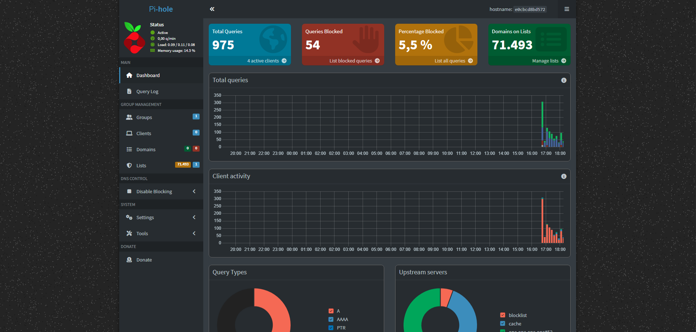
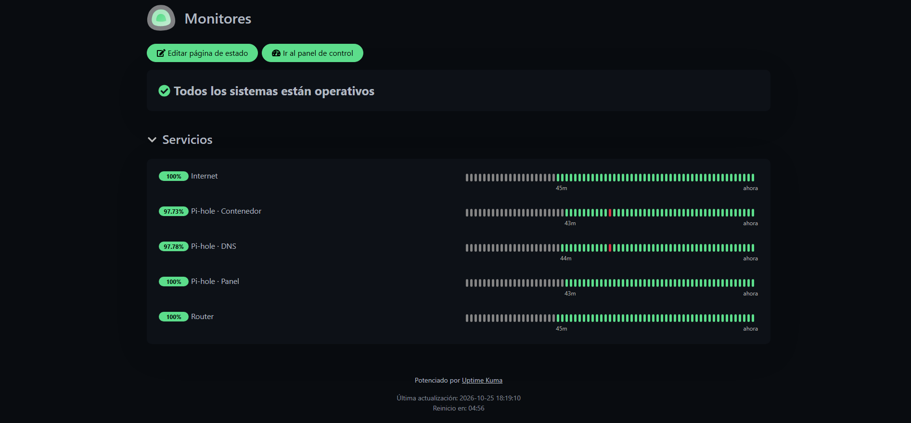
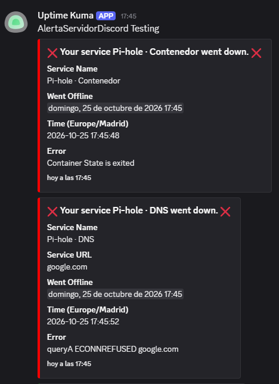

# Homelab: DNS con bloqueo de anuncios y monitorización con Docker

Servidor doméstico montado desde cero sobre una máquina virtual con Ubuntu Server. Ofrece **DNS con bloqueo de anuncios y rastreadores** para la red de casa (Pi-hole) y **monitorización de la red y los servicios con alertas en tiempo real** (Uptime Kuma + Discord). Todos los servicios se despliegan con Docker Compose y su configuración está versionada en este repositorio.



## Resumen

| | |
|---|---|
| **Infraestructura** | VM con Ubuntu Server en VirtualBox (Windows 11), red en modo puente |
| **Contenedores** | Docker + Docker Compose |
| **DNS** | Pi-hole v6 con 71.000+ dominios bloqueados y reenvío a Cloudflare y Quad9 |
| **Monitorización** | Uptime Kuma v2: 5 monitores por capas, página de estado y alertas por Discord |
| **Acceso** | SSH con autenticación por clave, IP estática |

En su primera tarde en funcionamiento, Pi-hole procesó **975 consultas DNS de 4 dispositivos y bloqueó 54** (5,5 %) dirigidas a dominios de publicidad y rastreo.

## Servicios

### Pi-hole: DNS con bloqueo de anuncios

Pi-hole actúa como servidor DNS de los dispositivos de la red. Cuando un dispositivo pide la IP de un dominio de publicidad o rastreo, Pi-hole responde con `0.0.0.0` y el contenido nunca se descarga. Las consultas legítimas se reenvían a Cloudflare (`1.1.1.1`) y Quad9 (`9.9.9.9`).

Funciona para cualquier dispositivo de la red sin instalar nada en él: basta con configurar su DNS.

### Uptime Kuma: monitorización y alertas

Los monitores están organizados **por capas**, de modo que ante un fallo se sabe exactamente dónde está el problema:

| Monitor | Tipo | Qué comprueba |
|---|---|---|
| Router | Ping a `192.168.0.1` | La red local |
| Internet | Ping a `1.1.1.1` | La salida a internet |
| Pi-hole · DNS | Consulta DNS de `google.com` a `192.168.0.245:53` | Que Pi-hole resuelve consultas |
| Pi-hole · Panel | HTTP a `/admin/` | Que la web de administración responde |
| Pi-hole · Contenedor | Estado del contenedor Docker | Que el contenedor está en marcha |

Si cae solo el contenedor, fallan los monitores de Pi-hole pero no Router ni Internet; si cae la conexión, falla Internet pero no la red local. Las alertas llegan a un canal de Discord mediante webhook.



## Prueba de fallo

Para validar la monitorización se detuvo Pi-hole a propósito (`docker stop pihole`):

- **En segundos**, Uptime Kuma detectó la caída del contenedor (`Container State is exited`) y del servicio DNS (`queryA ECONNREFUSED`).
- Las alertas llegaron a Discord con el servicio afectado, la hora y el error.
- Al arrancar de nuevo el contenedor, llegó el aviso de recuperación.



## Decisiones técnicas

- **Red en modo puente.** La VM obtiene su propia IP en la red doméstica, como un equipo físico más. Es imprescindible para que el resto de dispositivos puedan usarla como DNS.
- **IP estática con Netplan.** Un servidor DNS no puede cambiar de IP. Se configuró en `/etc/netplan/` y se desactivó la gestión de red de `cloud-init` para que no sobrescriba la configuración al reiniciar. Se aplicó con `netplan try`, que revierte los cambios automáticamente si se pierde la conexión.
- **SSH solo con claves.** La administración se hace por SSH desde Windows con claves `ed25519`, sin escribir contraseñas.
- **Conflicto en el puerto 53.** Ubuntu ocupa ese puerto con el *stub listener* de `systemd-resolved`. Se desactivó para que Pi-hole pudiera atender las consultas DNS.
- **Secretos fuera del repositorio.** La contraseña de Pi-hole se lee de un archivo `.env` excluido en `.gitignore`. El repositorio incluye un `.env.example` como plantilla. Los datos de los servicios tampoco se versionan.
- **Socket de Docker en solo lectura.** Uptime Kuma monta `/var/run/docker.sock` en modo `ro` para vigilar el estado de los contenedores. Es un compromiso consciente: quien accede al socket tiene mucho control sobre el host, algo aceptable en un homelab pero que en producción se limitaría con un proxy del socket.
- **DNS configurado por dispositivo, no en el router.** La VM solo está activa con el PC encendido. Si el router dependiera de ella, al apagar el PC se quedaría sin DNS toda la casa. Cada equipo usa Pi-hole como DNS principal y `1.1.1.1` como respaldo.

## Estructura del repositorio

```
homelab/
├── pihole/
│   ├── docker-compose.yml
│   └── .env.example        # plantilla de variables (el .env real no se sube)
├── uptime-kuma/
│   └── docker-compose.yml
├── docs/img/               # capturas
└── .gitignore
```

## Despliegue

Requisitos: un servidor Linux con Docker y Docker Compose, y el puerto 53 libre.

```bash
git clone git@github.com:robertvalentinmol/homelab.git
cd homelab

# Pi-hole
cd pihole
cp .env.example .env        # edita .env y pon tu contraseña
docker compose up -d

# Uptime Kuma
cd ../uptime-kuma
docker compose up -d
```

- Panel de Pi-hole: `http://IP_DEL_SERVIDOR/admin`
- Uptime Kuma: `http://IP_DEL_SERVIDOR:3001`

## Problemas encontrados y cómo los resolví

| Problema | Causa | Solución |
|---|---|---|
| Pi-hole no podía arrancar en el puerto 53 | `systemd-resolved` de Ubuntu ya lo ocupaba | Desactivar su *stub listener* y enlazar `/etc/resolv.conf` a la configuración real |
| Telegram no permitía crear el bot de alertas | Límite temporal de BotFather | Cambio a webhook de Discord, soportado de forma nativa por Uptime Kuma |
| La VPN no era accesible desde fuera | **Doble NAT** (router doméstico detrás del de la operadora) y **CG-NAT** de la operadora: el router no tiene IP pública propia | Diagnosticado comparando la IP WAN de cada router con la IP pública real. VPN aplazada (ver próximos pasos) |

## Próximos pasos

- **Acceso remoto por VPN.** Con CG-NAT no es posible recibir conexiones entrantes. Alternativas evaluadas: solicitar una IP pública a la operadora y abrir el puerto UDP en ambos routers para WireGuard, o usar una VPN *mesh* basada en WireGuard (como Tailscale) que no requiere abrir puertos.
- **Monitor de red en Python** que detecte dispositivos nuevos en la red y avise por Discord.
- **Analizador de logs con IA** que revise los registros de Pi-hole y del sistema y explique las anomalías en lenguaje natural.
- **Copias de seguridad** automáticas de la configuración de los servicios.

## Lo que he aprendido

Administración de Linux por SSH, configuración de red con Netplan, funcionamiento de DNS, despliegue de servicios con Docker Compose, gestión de secretos en Git, monitorización por capas y alertas, y diagnóstico de problemas reales de red como el doble NAT y el CG-NAT. He utilizado inteligencia artifical para guiarme en pasos en los que me atascaba y poder optimizar visualmente el README.md

---

Robert Valentin Moldovanu· Estudiante de Ingeniería Informática en la Universitat Jaume I · [LinkedIn](https://www.linkedin.com/in/robert-moldovanu/)
